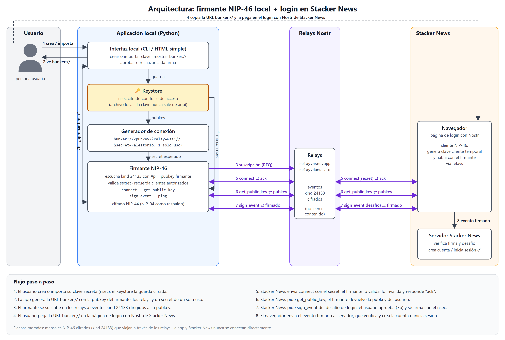

# Firmante NIP-46 mínimo para iniciar sesión en Stacker News

Aplicación mínima en **Python** que permite a un usuario crear o importar una clave secreta de Nostr, custodiarla localmente y usarla a través de un **firmante remoto NIP-46** (implementado en este repositorio) para iniciar sesión en [Stacker News](https://stacker.news).

> Prueba técnica — Desarrollador Full-Stack Semi Senior, Ministerio de Hacienda.
> Estado: **en desarrollo**. Las secciones marcadas con _(pendiente)_ se completarán al cerrar la implementación.

---

## 1. Cómo funciona

Nostr permite que una aplicación (el *cliente*, aquí Stacker News) pida firmas a un *firmante* que guarda la clave privada, sin que la clave salga nunca del firmante. La comunicación ocurre mediante eventos cifrados de **kind 24133** publicados en relays.



_Fuente editable: [`img/arquitectura.svg`](img/arquitectura.svg)._

URL generada:

```
bunker://<pubkey-firmante-hex>?relay=wss://relay1&relay=wss://relay2&secret=<aleatorio>
```

Métodos NIP-46 soportados: `connect`, `get_public_key`, `sign_event`, `ping` y `switch_relays` (responde `null`). Cualquier otro método responde con `error`, como exige la especificación.

### Estructura del código

| Archivo | Responsabilidad |
|---|---|
| [`signer/crypto.py`](signer/crypto.py) | Serialización e id de eventos (NIP-01), firma, cifrado NIP-44/NIP-04 |
| [`signer/nip46.py`](signer/nip46.py) | Lógica del firmante: URL `bunker://`, validación del `secret`, despacho de métodos |
| [`signer/relay.py`](signer/relay.py) | Conexión WebSocket a relays, suscripción, publicación, reconexión |
| [`signer/main.py`](signer/main.py) | Punto de entrada: arranque, aprobación en consola, registro en `logs/session.jsonl` |
| [`tools/demo_client.py`](tools/demo_client.py) | Cliente NIP-46 de prueba que simula a Stacker News |
| [`tests/test_nip46.py`](tests/test_nip46.py) | Pruebas unitarias offline |

## 2. Instalación y uso

Requisitos: Python 3.11+ (probado con 3.13 en Windows 11).

```bash
python -m venv .venv
.venv\Scripts\activate        # Windows  (Linux/macOS: source .venv/bin/activate)
pip install -r requirements.txt
```

**Iniciar el firmante**

```bash
python -m signer.main                       # genera una clave nueva y la muestra una vez
```

Para reutilizar una clave, define la variable `NSEC` antes de iniciar (PowerShell: `$env:NSEC="nsec1..."`; bash: `export NSEC=nsec1...`). Opciones: `--relay wss://...` (repetible) para cambiar relays, `-v` para ver el detalle de conexión.

**Iniciar sesión en Stacker News**

1. Copia la URL `bunker://...` que imprime el firmante.
2. Abre <https://stacker.news/signup?callbackUrl=https%3A%2F%2Fstacker.news%2F&type=nostr>, elige el login con Nostr remoto (NIP-46 / bunker) y pega la URL.
3. Cuando el firmante muestre la solicitud de firma, revisa el evento y responde `s`.

Cada solicitud y respuesta queda registrada en `logs/session.jsonl` (sin el `nsec` ni el `secret`).

**Pruebas**

```bash
python -m unittest -v
```

Prueba de punta a punta sin Stacker News (en otra terminal, con el firmante corriendo):

```bash
python -m tools.demo_client "bunker://..."
```

## 3. Alcance

**Incluido**

- Crear una clave nueva o importar una existente (`nsec` o hex).
- Guardar la clave en un archivo local cifrado con una frase de acceso.
- Firmante NIP-46 que genera la URL `bunker://`, escucha en relays y responde solicitudes.
- Aprobación explícita del usuario antes de cada `sign_event`.
- Demostración del login en Stacker News de punta a punta.

**Fuera de alcance (intencional)**

- Flujo `nostrconnect://` iniciado por el cliente: Stacker News acepta `bunker://`, que basta para el flujo pedido.
- Múltiples usuarios o múltiples claves.
- Billetera de producción, extensión de navegador o firmante universal (la consigna lo excluye explícitamente).
- Métodos `nip04_*`, `nip44_*` como servicio, `logout`, descubrimiento NIP-05/NIP-89.

## 4. Supuestos

| # | Tema | Supuesto | Justificación |
|---|------|----------|---------------|
| S1 | Clave del firmante vs. clave del usuario | Se usa la **misma** clave para ambos roles | NIP-46 lo permite; reduce complejidad sin afectar el flujo |
| S2 | Usuarios | Un solo usuario y una sola clave por instalación | La consigna habla de "un usuario" |
| S3 | Almacenamiento | Archivo local cifrado con frase de acceso (KDF + cifrado autenticado) | Protección razonable en reposo sin depender de servicios externos |
| S4 | Relays | Lista corta de relays públicos, configurable | Stacker News necesita alcanzar al firmante por relays compartidos |
| S5 | `secret` | Obligatorio y de un solo uso; luego se recuerdan los clientes autorizados | Evita que cualquiera que vea la pubkey del firmante pueda conectarse |
| S6 | Permisos (`perms`) | Se ignoran; la autorización real es la aprobación manual de cada firma | Simplicidad; la aprobación manual es más fuerte que permisos declarados |
| S7 | Cifrado de transporte | Se responde con NIP-44 (estándar actual); NIP-04 se acepta como respaldo si el cliente lo usa | Compatibilidad con clientes que aún no migran _(a confirmar con Stacker News)_ |
| S8 | Interfaz | CLI / interfaz web local mínima con HTML simple, sin frameworks de frontend | Permitido por la consigna; foco en el protocolo |
| S9 | Ejecución | El firmante corre en la máquina del usuario mientras dura el login | Basta para la demostración; no se busca un servicio 24/7 |

## 5. Tradeoffs

- **Librería Nostr vs. implementación propia.** Se usa [`nostr-sdk`](https://pypi.org/project/nostr-sdk/) (bindings Python de rust-nostr) solo para las primitivas criptográficas: curva secp256k1, firma Schnorr y cifrado NIP-44/NIP-04. No se usa su firmante NIP-46 incluido. La serialización de eventos, la conexión a relays y toda la lógica NIP-46 (suscripción, despacho de métodos, validación del `secret`, aprobación) están implementadas en este repo, porque la consigna pide un firmante *implementado por la persona postulante*. Se descartó `pynostr` porque no implementa NIP-44, el cifrado que exige NIP-46 hoy; implementar NIP-44 desde cero era viable pero excedía el tiempo sugerido.
- **Misma clave para firmante y usuario (S1).** Más simple; a cambio, la pubkey del usuario queda expuesta en la URL `bunker://`. Separarlas aislaría mejor la identidad, a costa de otra clave más que gestionar.
- **Aprobación manual de firmas.** Agrega una interacción, pero evita que un cliente conectado firme eventos arbitrarios en nombre del usuario.
- **Relays públicos.** Sin infraestructura propia, pero el flujo depende de su disponibilidad. En las pruebas, `relay.damus.io` respondió HTTP 503 y `relay.nsec.app` agotó el tiempo de conexión de forma intermitente; por eso se usan tres relays por defecto y cada conexión se reintenta con espera exponencial.
- **Archivo local cifrado vs. llavero del sistema operativo.** Portable y fácil de revisar; el llavero del sistema sería más seguro pero dependiente de la plataforma.

## 6. Preguntas abiertas

Puntos no especificados que se resuelven observando el comportamiento real de Stacker News (el firmante registra cada solicitud recibida):

- ¿Qué `kind` y qué contenido tiene el evento de autenticación que Stacker News pide firmar?
- ¿Stacker News cifra las solicitudes con NIP-44 o NIP-04?
- ¿Envía `switch_relays` u otros métodos además de los soportados?

Las respuestas se documentarán aquí al confirmarlas.

## 7. Demostración _(pendiente)_

Capturas o video del flujo completo: creación de clave → URL `bunker://` → conexión desde Stacker News → aprobación de firma → sesión iniciada.

## 8. Uso de agente de IA

El desarrollo se realizó con **Claude Code**. Las transcripciones de las conversaciones están en [`ai-logs/`](ai-logs/) _(pendiente)_.

## 9. Referencias

- [Nostr](https://nostr.com)
- [NIP-46 — Nostr Remote Signing](https://github.com/nostr-protocol/nips/blob/master/46.md)
- [NIP-44 — Encrypted Payloads](https://github.com/nostr-protocol/nips/blob/master/44.md)
- [Login con Nostr en Stacker News](https://stacker.news/signup?callbackUrl=https%3A%2F%2Fstacker.news%2F&type=nostr)
