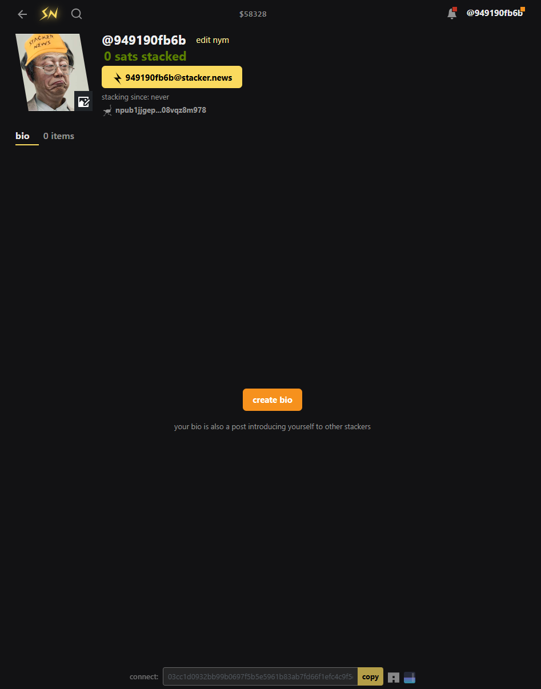

# Firmante NIP-46 mínimo para iniciar sesión en Stacker News

Aplicación mínima en **Python** que permite a un usuario crear o importar una clave secreta de Nostr, custodiarla localmente y usarla a través de un **firmante remoto NIP-46** (implementado en este repositorio) para iniciar sesión en [Stacker News](https://stacker.news).

> Prueba técnica — Desarrollador Full-Stack Semi Senior, Ministerio de Hacienda.
> Estado: **en desarrollo**. Las secciones marcadas con _(pendiente)_ se completarán al cerrar la implementación.

---

## 1. Cómo funciona

Nostr permite que una aplicación (el *cliente*, aquí Stacker News) pida firmas a un *firmante* que guarda la clave privada, sin que la clave salga nunca del firmante. La comunicación ocurre mediante eventos cifrados de **kind 24133** publicados en relays.


_Fuente editable: [`img/arquitectura.svg`](img/arquitectura.svg)._

URL generada:

```
bunker://<pubkey-firmante-hex>?relay=wss://relay1&relay=wss://relay2&secret=<aleatorio>
```

Métodos NIP-46 soportados: `connect`, `get_public_key`, `sign_event`, `ping` y `switch_relays` (responde `null`). Cualquier otro método responde con `error`, como exige la especificación.

### Estructura del código

| Archivo | Responsabilidad |
|---|---|
| [`signer/crypto.py`](signer/crypto.py) | Serialización e id de eventos (NIP-01), firma, cifrado NIP-44/NIP-04 |
| [`signer/nip46.py`](signer/nip46.py) | Lógica del firmante: URL `bunker://`, validación del `secret`, despacho de métodos |
| [`signer/relay.py`](signer/relay.py) | Conexión WebSocket a relays, suscripción, publicación, reconexión |
| [`signer/approvals.py`](signer/approvals.py) | `ApprovalHandler` (contrato) y `ApprovalManager`: cola asíncrona de solicitudes de firma con tiempo límite |
| [`signer/service.py`](signer/service.py) | `SignerService`: ciclo de vida de relays y procesamiento concurrente de eventos, independiente de la interfaz |
| [`signer/audit.py`](signer/audit.py) | Auditoría en `logs/session.jsonl` con minimización de datos (sin `secret`, firmas ni contenido) |
| [`signer/vault.py`](signer/vault.py) | Bóveda cifrada: generar/importar/validar clave, scrypt + AES-256-GCM, persistencia atómica, bloqueo/desbloqueo |
| [`signer/main.py`](signer/main.py) | Interfaz de consola (alternativa): `init` (crear/importar bóveda), desbloqueo, URL y aprobación |
| [`app/main.py`](app/main.py) | Aplicación web FastAPI: composición, `lifespan` (arranque/cierre ordenado), middleware |
| [`app/security.py`](app/security.py) | Validación de Host/Origin, sesión local, CSRF y encabezados de seguridad |
| [`app/dependencies.py`](app/dependencies.py) | Estado compartido (una sola `ApprovalManager`) y controles de sesión/CSRF |
| [`app/services/`](app/services/) | `VaultService` (scrypt en un hilo, sin bloquear el event loop) y `SignerRuntime` (inicia/detiene `SignerService`) |
| [`app/routes/`](app/routes/) | `wallet.py` (bóveda), `signer.py` (estado, nueva URL), `approvals.py` (solicitudes), `pages.py` (HTML) |
| [`app/templates/`](app/templates/), [`app/static/`](app/static/) | Jinja2 + CSS + JavaScript nativo (sin frameworks) |
| [`tools/demo_client.py`](tools/demo_client.py) | Cliente NIP-46 de prueba que simula a Stacker News |
| [`tests/`](tests/) | Pruebas offline: protocolo, aprobaciones, servicio, bóveda, consola y aplicación web |

## 2. Instalación y uso

Requisitos: Python 3.11+ (probado con 3.13 en Windows 11).

```bash
python -m venv .venv
.venv\Scripts\activate        # Windows  (Linux/macOS: source .venv/bin/activate)
pip install -r requirements.txt
```

### Interfaz web (recomendada)

```bash
python -m app                         # abre http://127.0.0.1:8046
```

1. **Configuración** (primera vez): crea una clave nueva o importa un `nsec`/hex, y define la contraseña de la bóveda. Si la clave es nueva, el `nsec` se muestra **una sola vez** para respaldarlo; hay que confirmar el respaldo para continuar.
2. **Desbloqueo** (siguientes veces): la contraseña descifra la bóveda e inicia el firmante.
3. **Panel**: estado de la bóveda, del firmante y de cada relay; clientes autorizados; la URL `bunker://` con botón **Copiar**, y **Generar nueva URL** (nuevo `secret`).
4. **Solicitudes**: cada firma pendiente muestra identificador, cliente, método, kind, contenido, tags y fecha, con **APROBAR** / **RECHAZAR** y una cuenta regresiva (se rechaza sola a los 120 s). El panel se actualiza cada 1,5 s.

Opciones: `--port`, `--vault RUTA` (por defecto `~/.nip46-signer/vault.json`), `--relay wss://...` (repetible), `--approval-timeout`. Siempre escucha en `127.0.0.1` (no es configurable).

**Iniciar sesión en Stacker News**

1. En el panel, pulsa **Copiar** junto a la URL `bunker://...`.
2. Abre <https://stacker.news/signup?callbackUrl=https%3A%2F%2Fstacker.news%2F&type=nostr>, elige el login con Nostr remoto (NIP-46 / bunker) y pega la URL.
3. La solicitud de firma (kind 27235) aparece en el panel: revísala y pulsa **APROBAR**.

Cada solicitud y respuesta queda registrada en `logs/session.jsonl` (sin el `nsec`, el `secret`, firmas ni contenido).

### Consola (alternativa)

```bash
python -m signer.main init            # crea la bóveda (o init --import para importar)
python -m signer.main                 # pide la contraseña, desbloquea e inicia; se aprueba con s/N
```

Usa la misma bóveda que la web. Opciones: `--relay`, `--approval-timeout`, `-v`. Solo para pruebas: `--ephemeral` (clave temporal que nunca se muestra ni guarda) y `--auto-approve`. La web **no** tiene autoaprobación.

**Pruebas**

```bash
pip install -r requirements-dev.txt   # agrega httpx (TestClient)
python -m unittest -v
```

Prueba de punta a punta sin Stacker News (en otra terminal, con el firmante corriendo):

```bash
python -m tools.demo_client "bunker://..."
```

## 3. Alcance

**Incluido**

- Crear una clave nueva o importar una existente (`nsec` o hex).
- Guardar la clave en un archivo local cifrado con una frase de acceso.
- Firmante NIP-46 que genera la URL `bunker://`, escucha en relays y responde solicitudes.
- Aprobación explícita del usuario antes de cada `sign_event`.
- Demostración del login en Stacker News de punta a punta.

**Fuera de alcance (intencional)**

- Flujo `nostrconnect://` iniciado por el cliente: Stacker News acepta `bunker://`, que basta para el flujo pedido.
- Múltiples usuarios o múltiples claves.
- Billetera de producción, extensión de navegador o firmante universal (la consigna lo excluye explícitamente).
- Métodos `nip04_*`, `nip44_*` como servicio, `logout`, descubrimiento NIP-05/NIP-89.

## 4. Supuestos

| # | Tema | Supuesto | Justificación |
|---|------|----------|---------------|
| S1 | Clave del firmante vs. clave del usuario | Se usa la **misma** clave para ambos roles | NIP-46 lo permite; reduce complejidad sin afectar el flujo |
| S2 | Usuarios | Un solo usuario y una sola clave por instalación | La consigna habla de "un usuario" |
| S3 | Almacenamiento | Archivo local cifrado con contraseña: scrypt + AES-256-GCM (sección 6) | Protección en reposo sin depender de servicios externos |
| S4 | Relays | Lista corta de relays públicos, configurable | Stacker News necesita alcanzar al firmante por relays compartidos |
| S5 | `secret` | Obligatorio y de un solo uso; luego se recuerdan los clientes autorizados | Evita que cualquiera que vea la pubkey del firmante pueda conectarse |
| S6 | Permisos (`perms`) | Se ignoran; la autorización real es la aprobación manual de cada firma | Simplicidad; la aprobación manual es más fuerte que permisos declarados |
| S7 | Cifrado de transporte | Se responde con NIP-44 (estándar actual); NIP-04 se acepta como respaldo si el cliente lo usa | **Confirmado como necesario:** Stacker News envía sus solicitudes con NIP-04 (ver sección 7) |
| S8 | Interfaz | Web local (FastAPI + Jinja2 + JS nativo, sin frameworks de frontend) y consola como alternativa | Permitido por la consigna; la consola conserva la demostración original |
| S10 | Operador | Una sola persona y una sola bóveda; sesiones en memoria que no sobreviven a un reinicio | Sin multiusuario por alcance; reiniciar exige volver a desbloquear |
| S9 | Ejecución | El firmante corre en la máquina del usuario mientras dura el login | Basta para la demostración; no se busca un servicio 24/7 |

## 5. Tradeoffs

- **Librería Nostr vs. implementación propia.** Se usa [`nostr-sdk`](https://pypi.org/project/nostr-sdk/) (bindings Python de rust-nostr) solo para las primitivas criptográficas: curva secp256k1, firma Schnorr y cifrado NIP-44/NIP-04. No se usa su firmante NIP-46 incluido. La serialización de eventos, la conexión a relays y toda la lógica NIP-46 (suscripción, despacho de métodos, validación del `secret`, aprobación) están implementadas en este repo, porque la consigna pide un firmante *implementado por la persona postulante*. Se descartó `pynostr` porque no implementa NIP-44, el cifrado que exige NIP-46 hoy; implementar NIP-44 desde cero era viable pero excedía el tiempo sugerido.
- **Misma clave para firmante y usuario (S1).** Más simple; a cambio, la pubkey del usuario queda expuesta en la URL `bunker://`. Separarlas aislaría mejor la identidad, a costa de otra clave más que gestionar.
- **Aprobación manual de firmas.** Agrega una interacción, pero evita que un cliente conectado firme eventos arbitrarios en nombre del usuario.
- **Relays públicos.** Sin infraestructura propia, pero el flujo depende de su disponibilidad. En las pruebas, `relay.damus.io` respondió HTTP 503 y `relay.nsec.app` agotó el tiempo de conexión de forma intermitente; por eso se usan tres relays por defecto y cada conexión se reintenta con espera exponencial.
- **Archivo local cifrado vs. llavero del sistema operativo.** Portable y fácil de revisar; el llavero del sistema sería más seguro pero dependiente de la plataforma.
- **Polling vs. Server-Sent Events/WebSocket.** La interfaz consulta la API cada 1,5 s: menos piezas y fácil de probar; la demora es imperceptible para una aprobación manual. Costo: unas pocas peticiones locales por segundo.
- **Una sola cola de aprobaciones.** La web y la consola usan la misma `ApprovalManager` que espera el firmante; no hay una segunda cola que sincronizar.
- **Nueva URL = reiniciar el firmante.** Generar un `secret` nuevo reinicia `SignerService` y olvida los clientes autorizados, sin tocar el protocolo NIP-46.
- **AES-256-GCM propio vs. NIP-49 (`ncryptsec`).** nostr-sdk ya implementa NIP-49 (scrypt + XChaCha20-Poly1305), que no requería dependencias nuevas y es interoperable con otros firmantes. Se eligió AES-256-GCM por requisito explícito del diseño, lo que agrega `cryptography` como dependencia y un formato de archivo propio (versionado).

## 6. Seguridad

### Bóveda

**Esquema criptográfico**

| Elemento | Elección | Motivo |
|---|---|---|
| Derivación | `scrypt` (stdlib), N=2¹⁷, r=8, p=1 → 32 bytes | Costosa en memoria (~128 MiB) y tiempo (~0,3 s medido): encarece ataques de diccionario. Nunca un hash rápido |
| Cifrado | AES-256-GCM (`cryptography`) | Cifrado autenticado: detecta contraseña incorrecta y archivos alterados |
| Aleatoriedad | `secrets.token_bytes`: salt de 16 bytes y nonce de 12 bytes **nuevos en cada guardado** | Sin valores constantes; dos bóvedas con la misma clave y contraseña son distintas |
| Datos asociados (AAD) | Encabezado: `version`, `pubkey`, parámetros de scrypt | Si alguien cambia la pubkey o baja el costo de scrypt en el archivo, el descifrado falla |
| Límites al leer | N entre 2¹⁴ y 2²⁰, r=8, p=1, largos de salt/nonce exactos | Un archivo manipulado no puede degradar el costo ni agotar la memoria |
| Verificación final | La clave descifrada debe producir la `pubkey` guardada | Segunda barrera contra corrupción |

**Qué se guarda en disco:** solo el JSON cifrado (pubkey pública, parámetros, salt, nonce, texto cifrado). Ni la contraseña ni el nsec, en ninguna forma. Las pruebas verifican que el archivo no contiene el nsec, el hex (texto ni bytes) ni la contraseña.

**Persistencia:** escritura atómica (temporal en el mismo directorio + `fsync` + `os.replace`); el temporal solo contiene datos ya cifrados y se elimina si algo falla. Sin `overwrite=True` nunca se reemplaza una bóveda existente. En Linux/macOS se aplican permisos `600`/`700`; en Windows la bóveda vive en el perfil del usuario (`~/.nip46-signer`), protegido por su ACL. Fuera del repositorio por defecto, y `.gitignore` excluye `vault/`, `*.vault.json` y temporales.

**En memoria:** la clave solo existe mientras la bóveda está desbloqueada (`get_signing_keys()` falla si está bloqueada). `lock_vault()` suelta la referencia; los bytes descifrados intermedios se sobrescriben con ceros.

**Fugas evitadas:** los errores de nostr-sdk y `cryptography` se re-lanzan con `from None` y mensajes genéricos, sin eco de la clave ni de la contraseña (probado sobre el traceback impreso). `repr()` de la bóveda y del resultado de creación ocultan el nsec. La consola lee clave y contraseña con `getpass` (sin eco). El nsec de una clave nueva se muestra una sola vez al crearla y no se puede volver a obtener. Se eliminó la variable de entorno `NSEC` (quedaba en el historial de la consola y en el entorno del proceso).

**Límites conocidos**

- Python no garantiza borrar la memoria: el objeto `Keys` (Rust) y los `str` intermedios (el hex que exige nostr-sdk, el texto ingresado en la consola) quedan hasta que el recolector los libera.
- La fortaleza depende de la contraseña: se exige un mínimo de 8 caracteres, sin medidor de calidad.
- GCM no distingue "contraseña incorrecta" de "archivo alterado"; ambos se informan como el mismo error.
- No hay límite de intentos persistente: la consola corta tras 3 intentos, pero un atacante con el archivo puede probar offline (lo frena solo el costo de scrypt).

### Seguridad de la interfaz web

**Amenaza principal:** el servidor escucha solo en `127.0.0.1`, pero cualquier página abierta en el navegador puede intentar llamarlo (CSRF) o hacer que su dominio apunte a `127.0.0.1` (DNS rebinding). Escuchar en localhost no basta, así que:

| Control | Implementación |
|---|---|
| Solo local | `uvicorn` en `127.0.0.1` fijo; el middleware rechaza clientes no locales |
| Host (anti DNS rebinding) | Solo `127.0.0.1:<puerto>` y `localhost:<puerto>`; cualquier otro → 403 |
| Origin | Obligatorio en POST y debe ser el propio; ausente o ajeno → 403 |
| CSRF | Doble envío: cookie HttpOnly `signer_csrf` + mismo token en el encabezado `X-CSRF-Token` (la página lo recibe en un `<meta>`) |
| Sesión | Cookie `signer_session` HttpOnly + `SameSite=Strict`, emitida solo tras probar la contraseña; se revocan todas al bloquear o detener el servidor |
| CORS | No se habilita: un origen ajeno no puede leer respuestas ni enviar encabezados propios |
| Encabezados | CSP `script-src 'self'` (sin scripts inline), `X-Frame-Options: DENY`, `Cache-Control: no-store`, `Referrer-Policy: no-referrer` |
| Datos no confiables | Contenido y tags de las solicitudes vienen del cliente remoto: se pintan con `textContent`, nunca `innerHTML` |
| Event loop | scrypt corre en un hilo (`asyncio.to_thread`); aprobar/rechazar resuelve un `Future`, sin bloquear relays ni API |

**Secretos en respuestas HTTP:** ningún endpoint devuelve la contraseña ni la clave. Única excepción deliberada: la respuesta de `POST /api/vault/create` incluye el `nsec` **una vez** para respaldo (con `Cache-Control: no-store`); la página lo muestra borroso, exige confirmar el respaldo y navega con `location.replace` para no dejarlo en el historial. Una clave importada nunca se devuelve. Los mensajes de error son textos fijos, sin eco de lo ingresado. Las pruebas recorren todas las respuestas buscando el `nsec`, el hex y las contraseñas.

**Ciclo de vida (`lifespan`):** al iniciar se crean los servicios con la bóveda bloqueada; el firmante y los relays arrancan recién al desbloquear. Al bloquear o detener el servidor: se cancelan las tareas en curso, las solicitudes pendientes se rechazan (nunca se firman), se cierran los relays, se suelta la clave y se revocan las sesiones.

## 7. Comportamiento observado de Stacker News

La especificación no dice qué pide Stacker News, así que el firmante registra cada solicitud en `logs/session.jsonl` y las preguntas se resolvieron con una sesión real (20-11-2026):

| Pregunta | Observado |
|---|---|
| ¿Qué cifrado usa? | **NIP-04**, no NIP-44. El respaldo NIP-04 (S7) resultó indispensable: con solo NIP-44 el login habría fallado. |
| ¿Qué métodos envía y en qué orden? | `connect` → `get_public_key` → `sign_event`. No envía `switch_relays` ni `ping`. |
| ¿Qué parámetros trae `connect`? | El primer parámetro (pubkey del firmante) llega **vacío**; solo trae el `secret`. Por eso el firmante acepta un destinatario vacío y valida solo el `secret`. |
| ¿Qué evento pide firmar? | **kind 27235** (autenticación HTTP, NIP-98), con `content` `"Stacker News Authentication"` y tags `challenge` (desafío del servidor), `u` = `https://stacker.news` y `method` = `GET`. |

Solicitud `sign_event` recibida (resumida):

```json
{
  "kind": 27235,
  "content": "Stacker News Authentication",
  "tags": [["challenge", "9f32bcd8…"], ["u", "https://stacker.news"], ["method", "GET"]],
  "created_at": 1795200139
}
```

Además, el cliente incluyó `pubkey` e `id` en el evento sin firmar; el firmante los ignora y los recalcula con la clave del usuario.

## 8. Demostración

Login real en Stacker News realizado el 20-11-2026 con una clave generada por el firmante (solo para pruebas).

**1. Salida del firmante** (resumida; el `nsec` se omite):

```
[init] pubkey usuario: npub1jjgep7mt8qzr4np6a4ftgfkyj6yal7w4x65ysv3v5xcngr9z08vqz8m978
[init] Pega esta URL en Stacker News (login con Nostr):
  bunker://949190fb…?relay=wss%3A%2F%2Frelay.nsec.app&relay=…&secret=…
[req]  de=2a6948324998… cifrado=nip04 connect (secret recibido)
[resp] ack
[req]  de=2a6948324998… cifrado=nip04 get_public_key params=[]
[resp] 949190fb6b38043acc3aed52b426c49689dff9d536a848322ca1b1340ca279d8
[req]  de=2a6948324998… cifrado=nip04 sign_event kind=27235 tags=[['challenge', '9f32…'], ['u', 'https://stacker.news'], ['method', 'GET']] content='Stacker News Authentication'
¿Firmar este evento? [s/N] s
[resp] {"pubkey": "949190fb…", "kind": 27235, …}
```

**2. Resultado en Stacker News:** se creó la cuenta e inició sesión como `@949190fb6b`, con el mismo `npub1jjgep…08vqz8m978` que mostró el firmante.



## 9. Uso de agente de IA

El desarrollo se realizó con **Claude Code**. Las transcripciones de las conversaciones están en [`ai-logs/`](ai-logs/) _(pendiente)_.

## 10. Referencias

- [Nostr](https://nostr.com)
- [NIP-46 — Nostr Remote Signing](https://github.com/nostr-protocol/nips/blob/master/46.md)
- [NIP-44 — Encrypted Payloads](https://github.com/nostr-protocol/nips/blob/master/44.md)
- [Login con Nostr en Stacker News](https://stacker.news/signup?callbackUrl=https%3A%2F%2Fstacker.news%2F&type=nostr)
