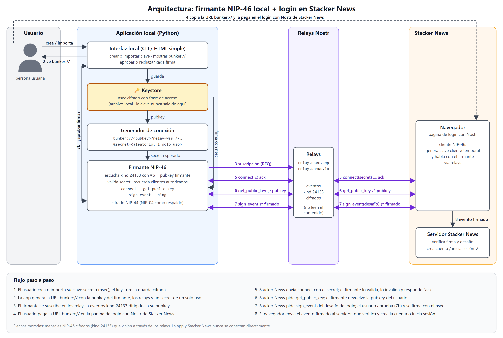
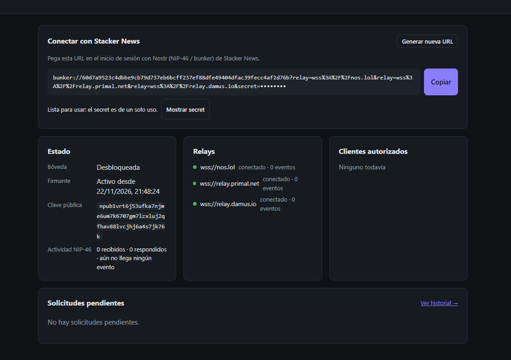
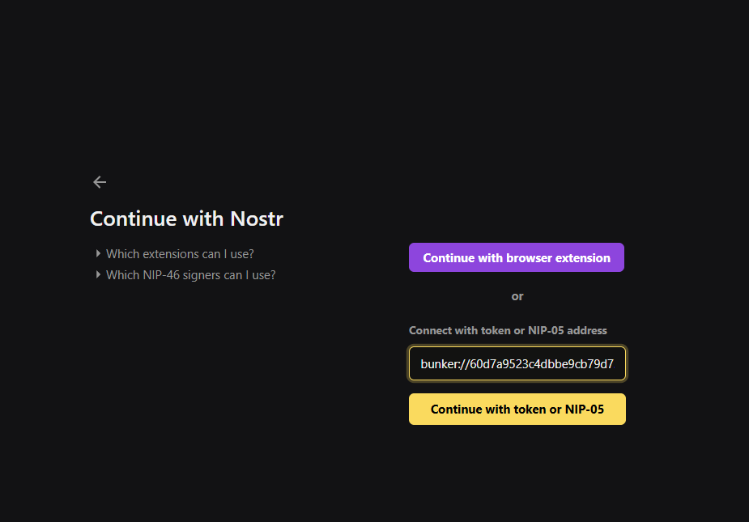
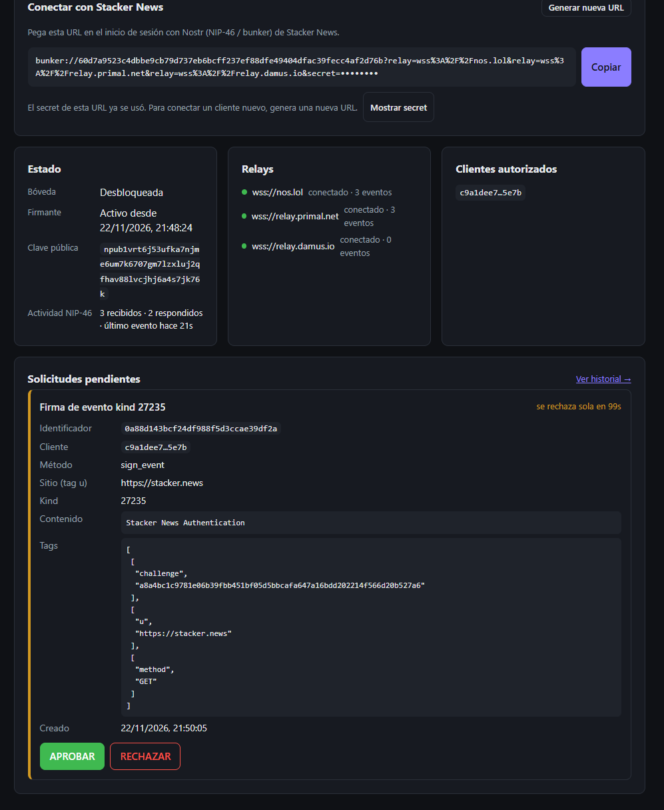
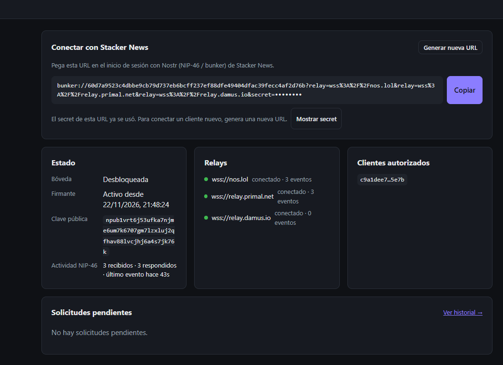
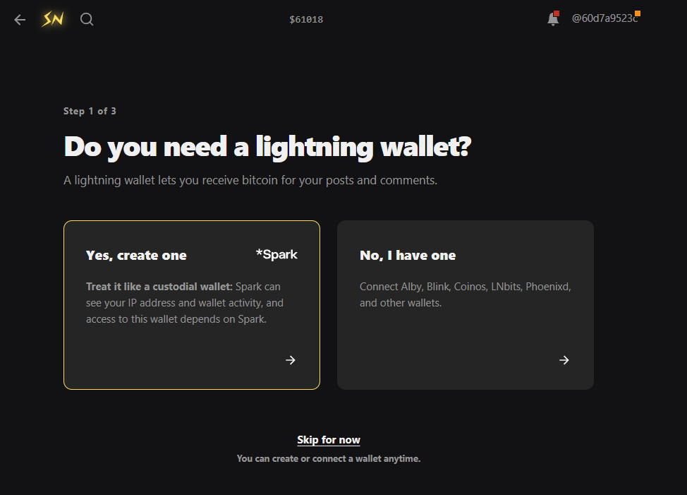
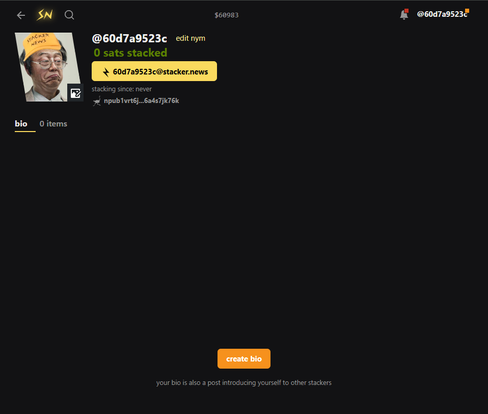
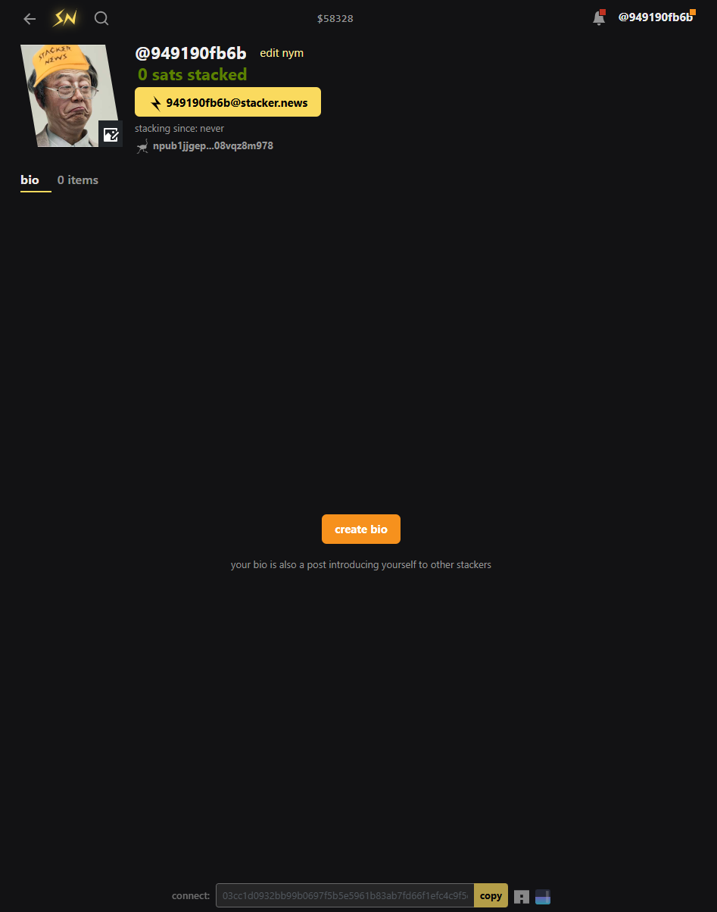

# Documentación técnica

[← Volver al README](../README.md) · [Manual de instalación y uso](MANUAL_INSTALACION.md)

## Cumplimiento de la consigna

Demostrar la firma remota NIP-46 de punta a punta con el menor alcance que cumple la consigna, documentando supuestos y tradeoffs.

| Requisito de la consigna | Cumplimiento |
|---|---|
| Ingresar o crear una clave secreta de Nostr | ✅ Web (pantalla de configuración) y consola (`init`, `init --import`); nsec o hex |
| Esa clave es usada por un firmante NIP-46 implementado por la persona postulante | ✅ Protocolo propio (`signer/nip46.py`, `signer/service.py`, `signer/relay.py`); `nostr-sdk` solo para criptografía |
| Demostración del login en Stacker News de punta a punta | ✅ Login real verificado con la interfaz web el 22-11-2026 (y antes con la consola, el 20-11-2026); capturas en [Prueba real con Stacker News](#prueba-real-con-stacker-news) |
| Python, Rust, Elixir o Go; HTML/CSS/JS simples sin frameworks | ✅ Python 3.13; Jinja2 + CSS + JavaScript nativo |
| README con instalación, supuestos y tradeoffs | ✅ Este documento |
| Registros de conversación con el agente de IA | ✅ [`ai-logs/`](../ai-logs/) (saneados) |

## Arquitectura

Un solo proceso local con tres capas: **interfaz** (web o consola), **servicio del firmante** y **protocolo/criptografía**. La interfaz y el firmante comparten **una única cola de aprobaciones** (`ApprovalManager`): cuando llega un `sign_event`, el firmante espera en un `asyncio.Future` que la persona resuelve desde la web.

| Archivo | Responsabilidad |
|---|---|
| [`signer/crypto.py`](../signer/crypto.py) | Serialización e id de eventos (NIP-01), firma, cifrado NIP-44/NIP-04 (envoltorio de `nostr-sdk`) |
| [`signer/nip46.py`](../signer/nip46.py) | Protocolo NIP-46: URL `bunker://`, `secret` de un solo uso, validación del evento, despacho de métodos |
| [`signer/relay.py`](../signer/relay.py) | WebSocket a relays: suscripción, publicación, reconexión, eventos duplicados |
| [`signer/service.py`](../signer/service.py) | `SignerService`: valida, descifra, despacha y responde; una tarea por evento |
| [`signer/approvals.py`](../signer/approvals.py) | `ApprovalHandler` (contrato) y `ApprovalManager` (cola con tiempo límite, duplicados, límite de pendientes) |
| [`signer/vault.py`](../signer/vault.py) | Bóveda: generar/importar/validar clave, scrypt + AES-256-GCM, persistencia atómica, bloqueo |
| [`signer/audit.py`](../signer/audit.py) | Auditoría `logs/session.jsonl` con minimización de datos |
| [`signer/main.py`](../signer/main.py) | Interfaz de consola (alternativa) |
| [`app/main.py`](../app/main.py) | Aplicación FastAPI: composición, `lifespan`, middleware |
| [`app/security.py`](../app/security.py), [`app/dependencies.py`](../app/dependencies.py) | Host/Origin, sesión local, CSRF, encabezados; estado compartido |
| [`app/services/`](../app/services/) | `VaultService` (scrypt en un hilo) y `SignerRuntime` (inicia/detiene `SignerService`) |
| [`app/routes/`](../app/routes/) | `wallet.py` (bóveda), `signer.py` (estado, nueva URL), `approvals.py` (solicitudes), `pages.py` (HTML) |
| [`app/templates/`](../app/templates/), [`app/static/`](../app/static/) | Jinja2, CSS y JavaScript nativo |
| [`tools/demo_client.py`](../tools/demo_client.py) | Cliente NIP-46 que replica la solicitud de Stacker News (kind 27235, opción `--nip04`) |
| [`tools/export_ai_log.py`](../tools/export_ai_log.py) | Exporta y sanea la transcripción de Claude Code para `ai-logs/` |
| [`tests/`](../tests/) | 86 pruebas automatizadas ([Pruebas](#pruebas)) |

**Flujo NIP-46** (métodos soportados: `connect`, `get_public_key`, `sign_event`, `ping`, `switch_relays`; cualquier otro responde `error`):

1. Al desbloquear la bóveda, el firmante se suscribe a eventos kind 24133 dirigidos a su pubkey y genera `bunker://<pubkey>?relay=…&secret=<aleatorio>`.
2. Stacker News envía `connect` con el `secret`; el firmante lo valida, lo invalida (un solo uso), autoriza al cliente y responde `ack`.
3. `get_public_key` → pubkey del usuario.
4. `sign_event` → el evento se valida y queda **pendiente** en la web; al aprobar se firma con la clave de la bóveda; al rechazar (o a los 120 s) se responde `error` sin firmar.
5. Cada respuesta se cifra con el **mismo esquema** que usó el cliente (NIP-04 o NIP-44).

## Diagrama



_Fuente editable: [`img/arquitectura.svg`](../img/arquitectura.svg)._

## Tecnologías utilizadas

| Tecnología | Uso |
|---|---|
| Python 3.13 (compatible 3.11+), `asyncio` | Lenguaje y concurrencia |
| [`nostr-sdk`](https://pypi.org/project/nostr-sdk/) 0.45.2 | Solo primitivas: claves secp256k1, firma Schnorr, cifrado NIP-44/NIP-04 |
| `websockets` 17.4 | Conexión a relays |
| `cryptography` 50.0.2 + `hashlib.scrypt` | AES-256-GCM y derivación de la contraseña |
| FastAPI 0.165 + Uvicorn 0.54 + Jinja2 3.1 | Servidor web local y plantillas |
| HTML + CSS + JavaScript nativo | Interfaz, sin frameworks de frontend |
| `unittest` + `httpx` (TestClient) | Pruebas |

## Pruebas

### Automatizadas — 86 pruebas, todas pasan (1 omitida en Windows)

```bash
python -m unittest -v
```

| Archivo | Pruebas | Cubre |
|---|---|---|
| `test_nip46.py` | 9 | URL bunker, secret de un solo uso, cliente no autorizado, métodos, cifrado NIP-04/NIP-44 |
| `test_approvals.py` | 12 | Pendiente, aprobación, rechazo, timeout, concurrentes, duplicados, inexistente, doble resolución, cancelación |
| `test_service.py` | 8 | Flujo completo, rechazo sin firma, timeout, `ping` mientras una firma espera, detener sin firmar, evento inválido, auditoría sin secretos |
| `test_vault.py` | 19 (+1 POSIX omitida) | Generación, importación nsec/hex, claves inválidas sin eco, cifrado, contraseña incorrecta, 8 tipos de archivo corrupto, alteración detectada, bloqueo, reinicio, sin sobrescritura, archivo sin nsec |
| `test_cli.py` | 3 | La consola compila, sin bóveda explica cómo crearla, `init` no sobrescribe |
| `test_web.py` | 22 | Creación, importación, desbloqueo, bloqueo, inicio del firmante, bunker URL, solicitudes visibles, aprobación y rechazo con eventos NIP-04 reales, acceso sin sesión, CSRF, Origin/Host ajenos, CORS, cookies, secretos en respuestas, sin autoaprobación |
| `test_hardening.py` | 13 | Regresiones de la revisión final: validación del evento antes de aprobar, respuesta con el mismo esquema, eventos fuera de ventana, no dirigidos o alterados, cola acotada, duplicados entre relays, `secret` ausente de los logs, descartes contados y auditados, respuesta sin relay informada, relays por defecto |

### Manuales (navegador)

Recorridas en el navegador integrado sobre la app real (`python -m app`): configuración, respaldo del nsec, panel, copiar URL, solicitud visible, aprobar, rechazar, bloquear, contraseña incorrecta y desbloqueo. Sin errores en la consola del navegador. Capturas en [`img/evidencias/`](../img/evidencias/).

### Con relays reales (22-11-2026)

`tools/demo_client.py` replica a Stacker News (kind 27235 con `challenge`/`u`/`method`, cifrado NIP-04) contra la app web sobre `relay.damus.io` y `nos.lol` (`relay.nsec.app` no conectó desde la red de prueba):

- Aprobación desde la web → `RESULTADO: OK - firma válida del usuario`.
- Con los relays por defecto actuales (`nos.lol`, `relay.primal.net`, `relay.damus.io`): 3/3 conectados, las solicitudes llegaron por `nos.lol` y `relay.primal.net`, y el panel mostró 3 recibidas · 3 respondidas · 0 descartadas.
- Rechazo desde la web → el cliente recibió `user rejected the signature`, sin firma.

```bash
python -m tools.demo_client "bunker://…" --nip04
```

### Prueba real con Stacker News

Ejecutadas por la persona postulante en su navegador, con claves de prueba.

**22-11-2026 — interfaz web: verificada de punta a punta.**

1. Primer intento fallido: con los relays por defecto de entonces (`relay.nsec.app`, `relay.damus.io`, `nos.lol`) las solicitudes de Stacker News no llegaban. Diagnóstico: desde la red de prueba `relay.nsec.app` no respondía y `relay.damus.io` devolvía HTTP 503. Se cambiaron los relays por defecto y se agregó al panel el diagnóstico de eventos por relay y motivos de descarte.
2. Segundo intento, con `nos.lol`, `relay.primal.net` y `relay.damus.io`: se pegó la URL `bunker://` en "Connect with token or NIP-05"; llegaron `connect` → `get_public_key` → `sign_event` (kind 27235, `u` = `https://stacker.news`) por `nos.lol` y `relay.primal.net`; se aprobó desde la web y Stacker News creó la cuenta `@60d7a9523c` e inició sesión con la misma npub (`npub1vrt6j…6a4s7jk76k`) que muestra el panel.

| Panel antes de conectar | URL pegada en Stacker News | Solicitud kind 27235 en el panel |
|---|---|---|
|  |  |  |

| Firma aprobada (3 recibidos · 3 respondidos) | Sesión iniciada | Perfil con la misma npub |
|---|---|---|
|  |  |  |

El `secret` aparece oculto en las capturas; el `challenge` visible es un desafío de un solo uso ya consumido.

**20-11-2026 — prototipo de consola: verificado.** Stacker News creó la cuenta `@949190fb6b` con la npub que mostró el firmante (esa clave quedó expuesta en la conversación y se descartó).



## Limitaciones conocidas

- Python no garantiza borrar la memoria: el objeto `Keys` y los `str` intermedios (hex, contraseña) viven hasta que el recolector los libera.
- La fortaleza de la bóveda depende de la contraseña (mínimo 8 caracteres, sin medidor). Quien copie el archivo puede probar contraseñas offline; solo lo frena el costo de scrypt. La web no limita intentos de desbloqueo (es local y exige CSRF).
- GCM no distingue "contraseña incorrecta" de "archivo alterado".
- En Windows no se aplican permisos al archivo; lo protege la ACL del perfil del usuario.
- Los clientes autorizados y las sesiones viven en memoria: tras reiniciar hay que desbloquear y volver a pegar la URL.
- Depende de relays públicos: la URL `bunker://` incluye los relays configurados aunque alguno esté caído; si ninguno es compartido y alcanzable por ambos lados, las solicitudes no llegan. El panel lo hace visible (eventos por relay, recibidos/respondidos/descartados y motivo).
- `TestClient` de Starlette muestra un aviso de deprecación (recomienda `httpx2`); no afecta las pruebas.

## Seguridad

### Bóveda

| Elemento | Elección | Motivo |
|---|---|---|
| Derivación | `scrypt`, N=2¹⁷, r=8, p=1 → 32 bytes | ~128 MiB y ~0,3 s por intento: encarece ataques de diccionario; nunca un hash rápido |
| Cifrado | AES-256-GCM | Autenticado: detecta contraseña incorrecta y archivos alterados |
| Aleatoriedad | `secrets.token_bytes`: salt 16 B y nonce 12 B nuevos en cada guardado | Sin valores constantes |
| Datos asociados | `version`, `pubkey` y parámetros de scrypt | Cambiar la pubkey o bajar el costo en el archivo hace fallar el descifrado |
| Límites al leer | N entre 2¹⁴ y 2²⁰, r=8, p=1 | Un archivo manipulado no degrada el costo ni agota la memoria |
| Persistencia | Escritura atómica, sin sobrescritura, `600/700` en POSIX, fuera del repo | Sin estados intermedios ni bóvedas pisadas |

En disco solo hay datos cifrados; nunca la contraseña ni el nsec. Los errores se re-lanzan con mensajes fijos (sin eco de la clave o contraseña) y `repr()` oculta los secretos.

### Interfaz web

Escuchar en `127.0.0.1` no basta: cualquier página abierta en el navegador puede intentar llamar al servidor (CSRF) o apuntar su dominio a `127.0.0.1` (DNS rebinding).

| Control | Implementación |
|---|---|
| Solo local | Uvicorn en `127.0.0.1` fijo; el middleware rechaza clientes no locales |
| Host | Solo `127.0.0.1:<puerto>` y `localhost:<puerto>` (anti DNS rebinding) |
| Origin | Obligatorio en POST e igual al propio |
| CSRF | Cookie HttpOnly + mismo token en `X-CSRF-Token` |
| Sesión | Cookie HttpOnly + `SameSite=Strict`, solo tras probar la contraseña; se revoca al bloquear o detener |
| CORS | No habilitado |
| Encabezados | CSP `script-src 'self'`, `X-Frame-Options: DENY`, `Cache-Control: no-store`, `Referrer-Policy: no-referrer` |
| Datos remotos | Contenido y tags se pintan con `textContent`, nunca `innerHTML` |

**Secretos en respuestas:** ningún endpoint devuelve la contraseña ni la clave, salvo la respuesta de creación, que entrega el nsec **una vez** para respaldo (`no-store`). El `secret` de la URL se muestra oculto en el panel.

### Protocolo y servicio

| Riesgo | Control |
|---|---|
| Eventos manipulados | Se verifican id y firma Schnorr; se descartan los no dirigidos al firmante (tag `p`) |
| Repetición / eventos viejos | Se descartan solicitudes NIP-46 con `created_at` fuera de ±10 min |
| Evento malformado a firmar | `validate_unsigned`: kind entero 0–65535, `content` texto, tags listas de textos, `pubkey` igual al firmante, ≤ 64 KB; se valida **antes** de pedir aprobación |
| Cliente no autorizado | Solo `connect` con el `secret` autoriza; el resto responde `unauthorized` |
| Solicitudes que nunca se resuelven | Rechazo automático a los 120 s; al detener o bloquear, todo lo pendiente se rechaza |
| Duplicados | Ids vistos entre relays (acotado a 4096); reenvíos idénticos comparten la misma decisión |
| Saturación | Máximo 20 solicitudes pendientes; el resto se rechaza |
| Concurrencia | Una tarea por evento: una firma pendiente no bloquea `ping` ni a otros clientes |
| Diagnóstico | Cada evento descartado queda en la auditoría con su motivo (sin contenido) y se cuenta en el panel junto a los eventos por relay y las respuestas sin relay conectado |
| Logs | La auditoría no guarda el `secret`, firmas, eventos firmados ni contenido (solo kind, nombres de tags, largo y hash); el log de servicio no incluye el `secret` (probado) |

## Uso del agente de IA

El desarrollo completo se hizo con **Claude Code** en una sesión conducida por etapas: exploración del protocolo, README y diagrama primero, prototipo por consola y login real, y luego incrementos aprobados uno a uno (desacople del firmante, bóveda, web, revisión final). En [`ai-logs/`](../ai-logs/) están:

- [`ai-logs/README.md`](../ai-logs/README.md): forma de trabajo, decisiones relevantes con su origen y errores del agente detectados durante el trabajo.
- [`ai-logs/01-sesion-claude-code.md`](../ai-logs/01-sesion-claude-code.md): transcripción saneada (sin nsec, contraseñas, `secret` ni datos personales), generada con `tools/export_ai_log.py`.

## Referencias

- [Nostr](https://nostr.com)
- [NIP-46 — Nostr Remote Signing](https://github.com/nostr-protocol/nips/blob/master/46.md)
- [NIP-44 — Encrypted Payloads](https://github.com/nostr-protocol/nips/blob/master/44.md)
- [NIP-98 — HTTP Auth](https://github.com/nostr-protocol/nips/blob/master/98.md)
- [Login con Nostr en Stacker News](https://stacker.news/signup?callbackUrl=https%3A%2F%2Fstacker.news%2F&type=nostr)
