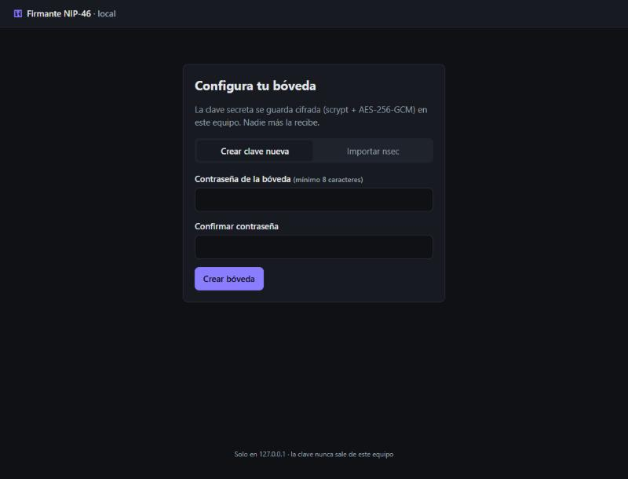
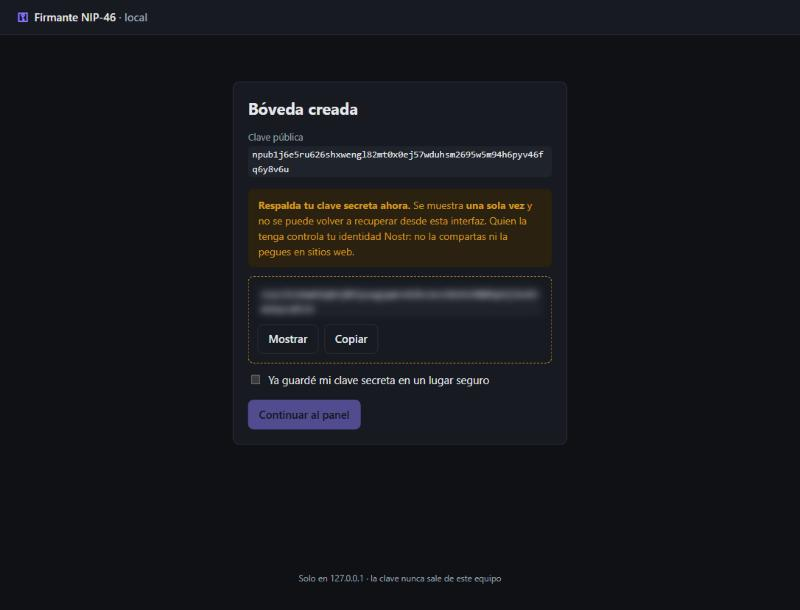
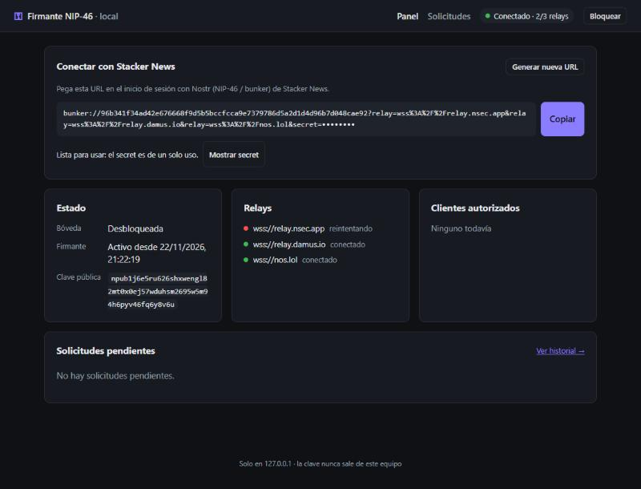
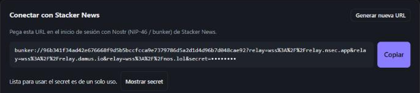
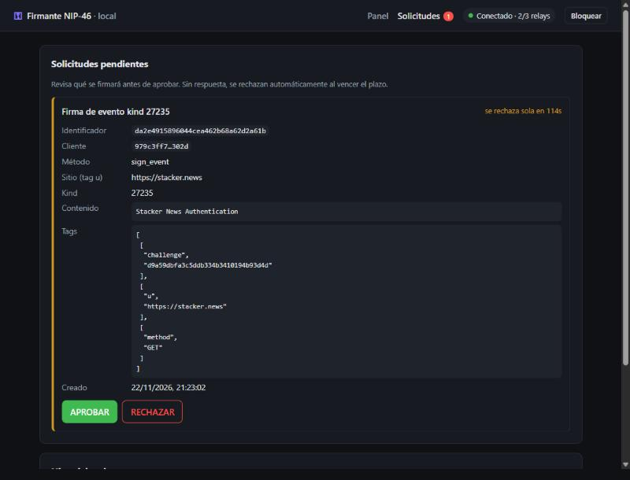
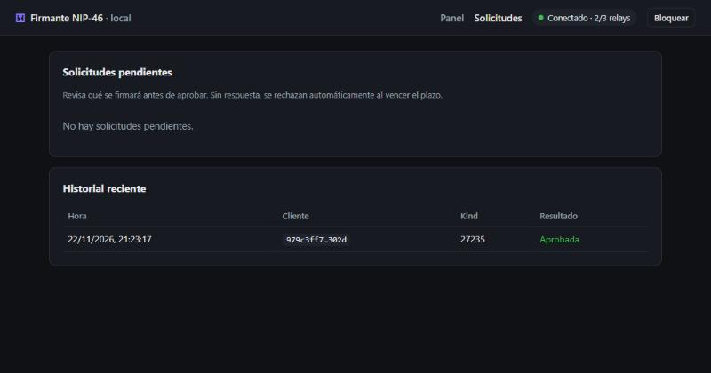
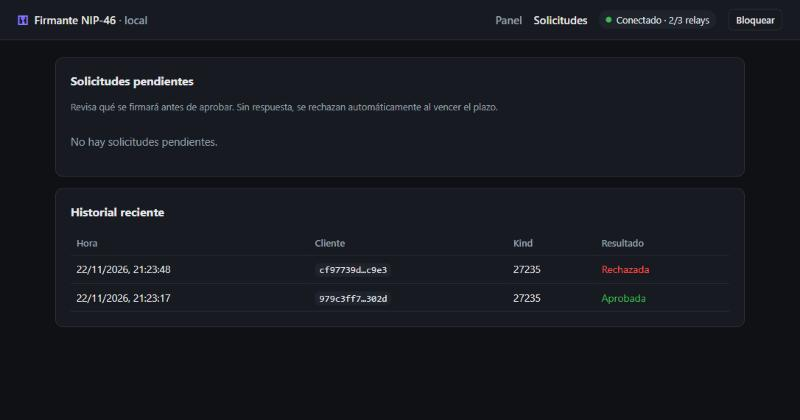

# Manual de instalación y uso

[← Volver al README](../README.md) · [Documentación técnica](DOCUMENTACION_TECNICA.md)

## Instalación

```bash
git clone https://github.com/jparaos/nostr-nip46-demo.git
cd nostr-nip46-demo
python -m venv .venv
.venv\Scripts\activate          # Windows  (Linux/macOS: source .venv/bin/activate)
pip install -r requirements.txt
pip install -r requirements-dev.txt   # solo para ejecutar las pruebas
```

## Configuración

No hay archivo de configuración: todo es por línea de comandos.

| Opción | Por defecto | Descripción |
|---|---|---|
| `--port` | `8046` | Puerto web. El host es siempre `127.0.0.1` (no configurable) |
| `--vault RUTA` | `~/.nip46-signer/vault.json` | Ubicación de la bóveda (fuera del repositorio). También `SIGNER_VAULT_PATH` |
| `--relay wss://…` (repetible) | `nos.lol`, `relay.primal.net`, `relay.damus.io` | Relays donde escucha el firmante (y que van en la URL `bunker://`) |
| `--approval-timeout` | `120` | Segundos antes de rechazar automáticamente una firma pendiente |

## Ejecución

```bash
python -m app            # interfaz web → abrir http://127.0.0.1:8046
```

Alternativa por consola (misma bóveda): `python -m signer.main` (ver `python -m signer.main --help`).

## Creación e importación de claves

En la primera ejecución, `http://127.0.0.1:8046` abre la **configuración**:

- **Crear clave nueva:** contraseña + confirmación → se genera la clave con `nostr-sdk`, se guarda cifrada y se muestra la clave pública. El `nsec` se muestra **una sola vez** (borroso hasta pulsar "Mostrar") con una advertencia; hay que marcar "Ya guardé mi clave secreta" para continuar. No se puede volver a recuperar desde la interfaz.
- **Importar nsec:** se pega un `nsec1…` o un hex de 64 caracteres; se valida, se cifra y se muestra la pubkey. Una clave importada nunca se devuelve.

Consola: `python -m signer.main init` o `init --import` (la clave se escribe oculta). Nunca se sobrescribe una bóveda existente.

| Configuración inicial | Clave creada (nsec oculto) |
|---|---|
|  |  |

## Uso de la bóveda

- **Desbloquear:** en ejecuciones siguientes, `/unlock` pide la contraseña. Si es incorrecta se muestra "Contraseña incorrecta. La bóveda sigue bloqueada."; la bóveda no se desbloquea hasta ingresar la correcta.
- **Bloquear:** botón **Bloquear** (arriba a la derecha). Detiene el firmante, rechaza lo pendiente sin firmar, suelta la clave de memoria y revoca la sesión.
- **Formato:** JSON con pubkey pública, parámetros de scrypt, salt, nonce y texto cifrado ([Seguridad](DOCUMENTACION_TECNICA.md#seguridad)).

## Inicio del firmante

El firmante arranca **al desbloquear** (o al crear/importar). El panel muestra:

- Estado de la bóveda, del firmante y de cada relay (conectado / reintentando) y un indicador de conexión.
- La URL `bunker://` con el `secret` **oculto en pantalla** (botón "Mostrar secret"); **Copiar** copia la URL completa.
- Clientes autorizados (solo pubkeys abreviadas) y solicitudes pendientes.
- **Generar nueva URL:** nuevo `secret` (el anterior es de un solo uso); olvida los clientes autorizados.



## Conexión con Stacker News

1. En el panel, **Copiar** la URL `bunker://…`.
2. Abrir <https://stacker.news/signup?callbackUrl=https%3A%2F%2Fstacker.news%2F&type=nostr>, elegir el login con Nostr remoto (NIP-46 / bunker) y pegar la URL.
3. Aprobar la solicitud que aparece en el panel ([Aprobación de solicitudes](#aprobación-de-solicitudes)).



**Comportamiento observado de Stacker News** (sesión real del 20-11-2026; el firmante registra cada solicitud):

| Pregunta | Observado |
|---|---|
| Cifrado | **NIP-04**, no NIP-44. Responder con el mismo esquema (supuesto S7 del [README](../README.md#supuestos)) resultó indispensable |
| Métodos y orden | `connect` → `get_public_key` → `sign_event`. No envía `switch_relays` ni `ping` |
| Parámetros de `connect` | El primero (pubkey del firmante) llega **vacío**; solo trae el `secret` |
| Evento a firmar | **kind 27235** (NIP-98): `content` `"Stacker News Authentication"`, tags `challenge`, `u` = `https://stacker.news`, `method` = `GET`. Incluye `pubkey` e `id`, que el firmante verifica/recalcula |

## Aprobación de solicitudes

Cada `sign_event` aparece en el panel y en **Solicitudes** con identificador, cliente, método, sitio (tag `u`), kind, contenido, tags y fecha de creación, más una cuenta regresiva.

- **APROBAR:** la decisión llega al `ApprovalManager`, el `Nip46Signer` firma con la clave de la bóveda y responde al cliente remoto.
- **RECHAZAR:** el firmante responde `error` (`user rejected the signature`) sin firmar.
- **Sin respuesta en 120 s:** se rechaza automáticamente. No existe autoaprobación en la web.

| Solicitud pendiente | Aprobada | Rechazada |
|---|---|---|
|  |  |  |
